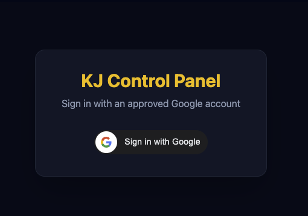
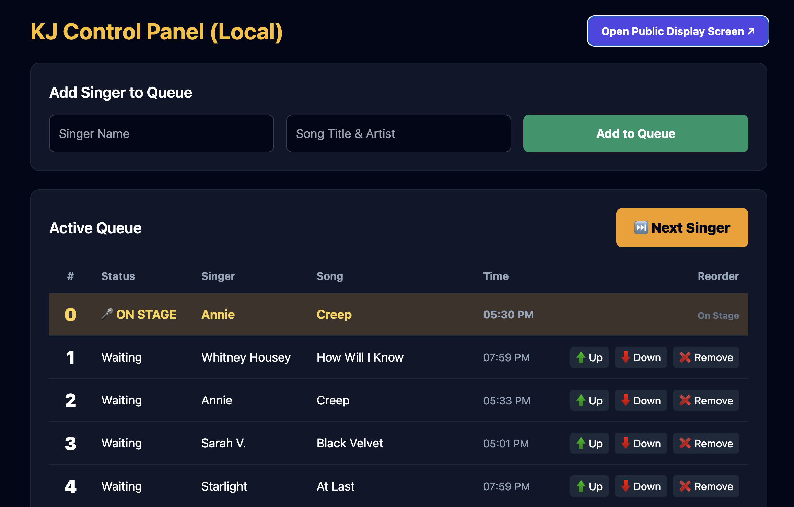
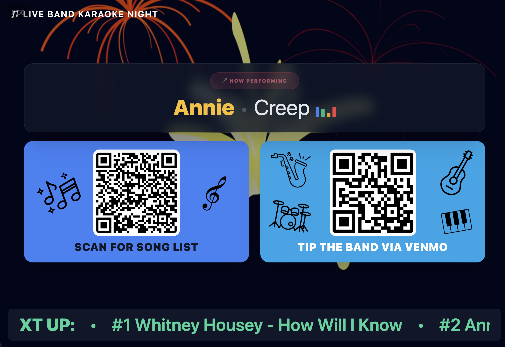

# Karaoke App

A simple karaoke queue for live band karaoke nights.

- **Display screen**: shows the current singer and song on a big monitor, a scrolling ticker of who's up next, and QR codes for the song list and for tipping the band. It only runs in a browser signed in as an admin, and it stops updating when you click **Sign out**, so an unattended screen doesn't keep calling the server. If nobody clicks or types on the admin console for 1 hour, you're signed out automatically and the display stops too (change `IDLE_MINUTES` in `lib/auth.js`).
- **Admin console**: add singers and their songs, move singers up or down in the queue, remove singers, and click **Next Singer** to bring the next person on stage. Only approved Google accounts can sign in.

The queue and the history of completed performances are saved in a Google Sheet with three tabs:

| Tab | What it holds |
|---|---|
| `queue` | Columns `order_number`, `singer`, `song`, `status`, `timestamp`. New requests are added as `Waiting`; the first `Waiting` row is the singer on stage, and **Next Singer** changes it to `Completed` |
| `history` | Every completed performance (time, order number, singer, song) |
| `admins` | The whitelist: one Gmail address per row, allowed into the admin console |
| `venmo_url` | Link for the Venmo QR code. Column A is a label, column B the link: the `primary` row is used if it has a link, otherwise the `default if primary is not set` row |
| `song_list_url` | Link for the song list QR code (the first link in the tab, e.g. cell A1) |

To change the QR codes for an event, edit the links in `venmo_url` or `song_list_url`; the display picks up the change within about a minute, no reload needed.

To give someone access, add their Gmail address to the `admins` tab. To remove access, delete their row (takes effect within a minute).

## Requirements

- [Node.js](https://nodejs.org) (download and install the LTS version)
- A Google account (owns the Sheet and the Google Cloud project)
- A [Netlify](https://www.netlify.com) account (to host it on the internet)

## One-time Google setup

1. **Create a Google Cloud project** at [console.cloud.google.com](https://console.cloud.google.com) and enable the **Google Sheets API** (APIs & Services → Library).
2. **Set up the consent screen** (APIs & Services → OAuth consent screen):
   - User type **External**, app name "Karaoke App".
   - Under **Data Access**, add the scope `.../auth/spreadsheets` ("See, edit, create, and delete all your Google Sheets spreadsheets").
   - Click **Publish app** so it's "In production". Otherwise Google expires the app's access every 7 days. Google doesn't need to review a personal app like this; when you authorize, you'll see "Google hasn't verified this app". Click **Advanced → Go to Karaoke App (unsafe)** to continue.
3. **Create the OAuth client** (APIs & Services → Credentials → Create credentials → OAuth client ID → **Web application**):
   - **Authorized JavaScript origins**: `http://localhost:3000` and your Netlify address (e.g. `https://your-site.netlify.app`)
   - **Authorized redirect URIs**: `http://localhost:3005/oauth2callback`
   - Copy the **Client ID** and **Client secret**.

## How to run on your computer

1. Open a terminal and go to the app folder:
   ```
   cd karaoke-app
   ```
2. Install everything the app needs (first time only):
   ```
   npm install
   ```
3. Copy `.env.example` to `.env` and fill in:
   - `GOOGLE_CLIENT_ID` and `GOOGLE_CLIENT_SECRET`: from setup step 3
   - `SHEET_ID`: your existing Google Sheet's ID, the long code in its URL: `https://docs.google.com/spreadsheets/d/`**`THIS_PART`**`/edit`. Leave it empty to have the next step create a new sheet.
   - `SESSION_SECRET`: a random value; generate one with
     ```
     node -e "console.log(require('crypto').randomBytes(32).toString('hex'))"
     ```
   - `TIME_ZONE`: your venue's time zone.
4. Connect your Google account (first time only). Sign in with the account that owns the sheet (or has Editor access to it) and tick every permission box. This saves `GOOGLE_REFRESH_TOKEN` into `.env`. If `SHEET_ID` is set, it checks that sheet opens; if it's empty, it creates a new sheet named `Karaoke-App-Annie-yyyy-mm-dd hh:mi:ss` in your Google Drive and saves its `SHEET_ID` into `.env`:
   ```
   node scripts/authorize.js
   ```
   The app only opens the sheet in `SHEET_ID`. To revoke its access at any time, go to [myaccount.google.com/permissions](https://myaccount.google.com/permissions).
5. Set up the Sheet's tabs and add yourself as the first admin (first time only). This also imports any existing `queue.json` and `history.csv`:
   ```
   node scripts/setup-sheet.js your.email@gmail.com
   ```
6. Start the app:
   ```
   node server.js
   ```
7. Open in your browser:
   - Admin console: http://localhost:3000 (you'll be asked to sign in with Google)
   - Display screen: http://localhost:3000/?view=display (or click **Open Public Display Screen** in the admin console)

   Drag the display screen to your big monitor and make it full screen.

8. To stop the app, press `Ctrl+C` in the terminal.

## Alternate start up (auto-restart with nodemon)

[nodemon](https://nodemon.io) restarts the app automatically whenever you edit `server.js`, which is handy while making changes.

1. Install everything the app needs:
   ```
   npm install
   ```
2. Install nodemon (first time only):
   ```
   npm install -g nodemon
   ```
3. Start the app:
   ```
   nodemon server.js
   ```

## Hosting on Netlify

1. Put the project on GitHub (the `.gitignore` keeps `.env` and other private files out).
2. In Netlify: **Add new site → Import an existing project** and pick the repository. The settings in `netlify.toml` are picked up automatically.
3. In **Site settings → Environment variables**, add the same values as your `.env`: `GOOGLE_CLIENT_ID`, `GOOGLE_CLIENT_SECRET`, `GOOGLE_REFRESH_TOKEN`, `SHEET_ID`, `SESSION_SECRET`, `TIME_ZONE`.
4. Deploy. Then add your Netlify address to **Authorized JavaScript origins** in the Google OAuth client (setup step 3).

- Admin console: `https://your-site.netlify.app`
- Display screen: `https://your-site.netlify.app/?view=display`

## Example Screenshots

### Admin Login

Login using a pre-authorized Google account.



### Admin Console

Enter singer's name and their song to the queue.
Move singer up or down in the queue order.
Remove singers if desired.
Click on "Open Public Display Screen" to see the public display view.



### Public Display

Public display can be shown with an external monitor to show the singer ticket and give them access to the QR codes.


